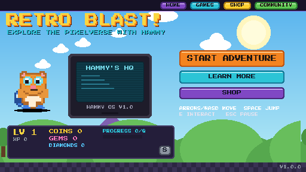

# RETRO BLAST! — Explore the Pixelverse with Hammy

Game platformer 2D retro pixel-art yang lengkap dan bisa dimainkan, dibuat dengh
Python + Pygame. Semua aset (sprite, tile, latar, musik, SFX) digenerate secara
prosedural oleh kode — tidak butuh file eksternal.



## Cara menjalankan

```bash
# 1. buat virtual environment (Python 3.14)
python -m venv .venv
.venv\Scripts\activate        # Windows
source .venv/bin/activate     # Linux/Mac

# 2. install dependensi
pip install -r requirements.txt

# 3. mainkan
python main.py
```

Atau tanpa instalasi (kalau pygame-ce + pillow sudah ada):

```bash
python main.py
python main.py --headless     # render beberapa frame tanpa jendela
python main.py --test         # verifikasi headless lengkap + screenshot
python tools/layout_check.py  # cek layout UI (bounds + overlap)
```

## Kontrol

| Aksi              | Keyboard            | Gamepad                  |
|-------------------|---------------------|--------------------------|
| Gerak             | A / D atau panah    | Analog stick / D-Pad     |
| Lompat            | SPACE (tahan = lebih tinggi) | A / Cross        |
| Interaksi / OK    | E atau ENTER        | B / Circle               |
| Dash              | SHIFT (jika dibeli) | LB / RB                  |
| Jeda              | ESC atau P          | START                    |
| Scroll toko       | Mouse wheel         | —                        |

## Isi game

- **4 dunia × 2 level** = 8 level: Pixel Grassland, Crystal Caverns, Neon City,
  Lava Fortress (level ke-2 tiap dunia dijaga boss dan pintu gerbang).
- **Hammy** dengan 10 animasi (idle, walk, run, jump, fall, land, hurt,
  victory, collect, dash) plus koyote time, jump buffer, variable jump height.
- **Kolektibel**: koin, diamond biru, gem kuning, kunci emas (buka pintu
  terkunci), mystery box, hati, bintang, magnet, pegas.
- **Musuh**: slime, walker, flyer, dan boss — dengan AI patrol, lompat, dan
  stump mechanics.
- **Rahasia**: lantai palsu yang bisa ditembus, patung checkpoint, XP level
  pemain, 8 achievement, toko (skin, ransel, aksesori, skill, power-up),
  save/load otomatis ke `save.json`.
- **Audio**: musik chiptune per dunia + 26 SFX, semuanya disintesis kode.

## Struktur proyek

```
retroblast/
  config.py    konstanta, palet, tema dunia
  assets.py    generator sprite/tile/latar/font (PIL) + loader
  audio.py     sintesis SFX + musik chiptune (stdlib wave)
  input.py     keyboard + gamepad + mouse
  levels.py    generator 8 level (deterministik, seeded)
  physics.py   tabrakan tile
  entities.py  Player, Enemy, Item, MovingPlatform, Particle
  world.py     render tile, kamera, alur level
  ui.py        semua layar + widget
  save.py      skema save, katalog toko, achievement
  game.py      mesin state
main.py        entry point
tests/         verifikasi headless + screenshot
tools/         layout check
```

## Verifikasi

`python main.py --test` menjalankan game loop nyata dengan SDL dummy driver,
menekan tombol lewat input palsu, lalu memeriksa: menu render, navigasi,
gerak pemain, lompat, ambil koin, kunci/pintu, exit → LEVEL CLEAR,
pause, toko, save/load, dan render ke-8 level — plus sampling piksel untuk
memastikan frame tidak kosong.

Tekan **F11** untuk layar penuh.
